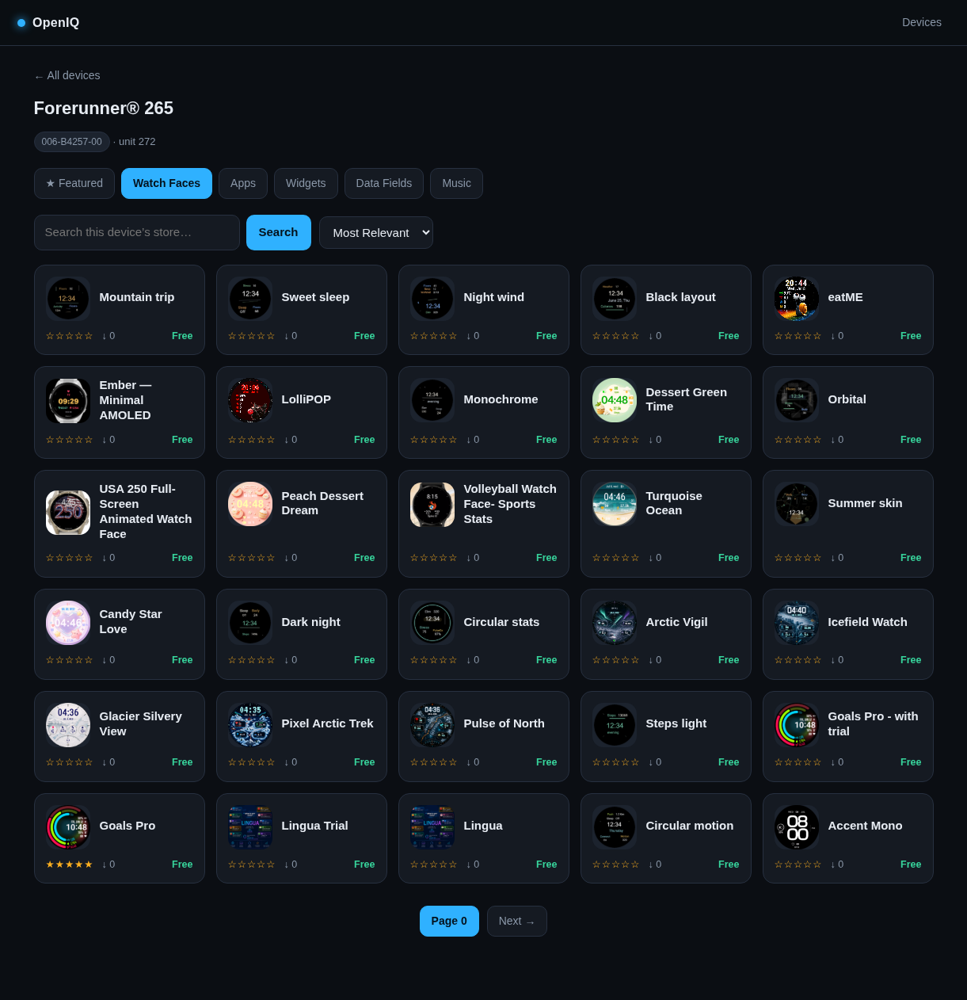

# OpenIQ — a self-hosted Garmin Connect IQ store in your browser

> Browse Garmin **watch faces, apps, widgets, and data fields** by device model
> from any web browser — a lightweight, self-hosted replacement for the Connect IQ
> store website that Garmin removed.

OpenIQ is a single, dependency-free **Go** web app that reverse-engineers Garmin's
Connect IQ *mobile* API. Pick any of the 354 supported Garmin devices (Forerunner,
Fenix, Venu, Epix, Instinct, Vívoactive, and more) and browse everything compatible
with it — the store experience Garmin shut down, running on your own machine or VPS.



## Features

- 🔎 **Browse by device** — select a Garmin model and see its compatible watch faces, apps, widgets, and data fields.
- ⌚ **Every model type** — watch faces, watch apps, widgets, data fields, and music/audio apps.
- 🔠 **Keyword search & sorting** — search a device's store and sort by rating, popularity, most recent, trending, or hot & fresh.
- 🐳 **Self-hostable** — run locally with `go run .` or deploy the Docker image behind Cloudflare / a reverse proxy.
- 📦 **Zero dependencies** — pure Go standard library; no framework, no database.
- 🔐 **Uses your own Garmin account** — signs in exactly like the mobile app via OAuth1.

## Configuration (secrets)

Browsing is authenticated with Garmin's **private** Connect IQ OAuth1 consumer
credentials, which are **not** shipped with this project. Supply your own before
running:

```bash
cp secrets.env.example secrets.env   # then fill in the two values
```

`secrets.env` is **gitignored** and auto-loaded at startup, so the credentials
never end up in committed source. (You can also just export the vars instead.)

| Variable | What it is |
|---|---|
| `GARMIN_CIQ_CONSUMER_KEY` / `..._SECRET` | **Required.** Connect IQ store OAuth1 consumer, found in the app's native `libsr.so` (`config.arm64_v8a` split): `strings libsr.so \| grep -A1 CIQ_APPSTORE_MOBILE`. The store derives your identity from a signature made with this consumer — a bearer token is rejected. |
| `GARMIN_LOGIN_CONSUMER_KEY` / `..._SECRET` | Optional. The public Garmin Connect Mobile consumer (built-in default works). |

> ⚠️ **Do not commit these or paste them into README/source.** Publishing them
> lets Garmin rotate the key (breaking the tool) and violates their ToS. Keep
> them in the gitignored `secrets.env`. The `.gitignore` already excludes it, the
> token cache, and the APK/decompilation artifacts.

## Run

```bash
cd app
go run .            # or: go build -o openiq . && ./openiq
```

Open http://localhost:8087 and sign in with your **Garmin Connect** account
(any account works — it needn't own any devices; MFA/2FA is not supported).

## Headless / server deployment (Docker)

For an unattended deployment (e.g. a VPS behind Cloudflare Zero Trust), set
`GARMIN_EMAIL` + `GARMIN_PASSWORD` in `secrets.env`. The app then signs in on
startup, hides the login form, and serves the store directly — access control is
delegated to whatever sits in front (Cloudflare, a reverse proxy, etc.).

### Quick VPS deploy (pull the published image)

You only need **two files** on the VPS — `docker-compose.yml` and `secrets.env`
(no need to clone the whole repo).

```bash
# 0. First publish an image once: repo → Actions → "Build & publish image" → Run workflow

# 1. On the VPS, in an empty dir, drop the two files:
#    - docker-compose.yml  (copy from this repo; set YOUR_GITHUB_USERNAME on the image line)
#    - secrets.env         (see the required keys below)

# 2. secrets.env — the minimum for headless mode:
cat > secrets.env <<'EOF'
GARMIN_CIQ_CONSUMER_KEY=...        # from libsr.so (see secrets.env.example)
GARMIN_CIQ_CONSUMER_SECRET=...
GARMIN_EMAIL=your-dedicated@account
GARMIN_PASSWORD=your-password      # unquoted; no MFA on this account
EOF
chmod 600 secrets.env

# 3. Log in to GHCR once (private package → needs a PAT with read:packages):
echo <YOUR_PAT> | docker login ghcr.io -u <your-username> --password-stdin

# 4. Pull + start:
docker compose pull && docker compose up -d
docker compose logs -f        # look for "auto-login OK"

# 5. Point your Cloudflare tunnel / reverse proxy at http://localhost:8087
```

> If you run `cloudflared` (or your proxy) as **another container**, it can't reach
> `127.0.0.1:8087` on the host — put both on the same Docker network and target
> `http://openiq:8087`, or change the port binding to `8087:8087`.

### Local build instead

```bash
cp secrets.env.example secrets.env    # fill in CIQ keys + GARMIN_EMAIL/PASSWORD
docker compose up -d --build          # (edit compose: comment `image:`, uncomment `build: .`)
```

- `docker-compose.yml` loads `secrets.env` on the host via `env_file` — the file
  never enters the image. Tokens persist in the `openiq-tokens` volume, so restarts
  don't re-login.
- It binds to `127.0.0.1:8087` by default; point your Cloudflare tunnel / reverse
  proxy at that. **Do not expose the port publicly without access control** — the
  app has no auth of its own (that's Cloudflare's job here).
- Env vars: `GARMIN_CIQ_CONSUMER_KEY/SECRET` (required), `GARMIN_EMAIL/PASSWORD`
  (headless login), `GARMIN_TOKEN_FILE` (token cache path, default `/data/tokens.json`),
  `ADDR` (listen address, default `:8087`).

Plain `docker run` works too:

```bash
docker build -t openiq .
docker run -d -p 127.0.0.1:8087:8087 --env-file secrets.env -v openiq-tokens:/data openiq
```

### Publish an image (GitHub Actions) and pull it on the VPS

A manual workflow builds the image and pushes it to the GitHub Container Registry:

1. In the repo: **Actions → "Build & publish image" → Run workflow** (optionally
   enter an extra tag). It publishes `ghcr.io/<your-username>/openiq:latest`.
   Uses the built-in token — no secrets to configure.

2. On the VPS, authenticate to GHCR once (the package is private since the repo
   is). Create a Personal Access Token with the `read:packages` scope, then:

   ```bash
   echo <YOUR_PAT> | docker login ghcr.io -u <your-username> --password-stdin
   ```

3. Point `docker-compose.yml` at your image (edit `YOUR_GITHUB_USERNAME`) and:

   ```bash
   docker compose pull && docker compose up -d
   ```

   Or without compose:

   ```bash
   docker pull ghcr.io/<your-username>/openiq:latest
   docker run -d --restart unless-stopped \
     -p 127.0.0.1:8087:8087 --env-file secrets.env \
     -v openiq-tokens:/data ghcr.io/<your-username>/openiq:latest
   ```

`secrets.env` lives only on the VPS (with your `GARMIN_*` values); it is never
built into the image.

- Change the port with `ADDR=:9000 go run .`
- OAuth tokens are cached at `~/.config/garmin-store-tokens.json` (chmod 600).
  Delete that file or click **Log out** to sign out.

## Why login is required

Only `/deviceTypes` and `/permissions` are public. Every browse endpoint requires an
**OAuth1-signed request** identifying a Garmin account, exactly like the mobile app.
The auth chain (all done in Go):

```
sso.garmin.com/sso/embed        (prime cookies)
sso.garmin.com/sso/signin       (scrape _csrf, POST credentials → ticket)
connectapi.garmin.com/oauth-service/oauth/preauthorized      (ticket → OAuth1 user token)
connectapi.garmin.com/oauth-service/oauth/tokens/consumer    (re-issue token under CIQ consumer)
```

Then every store request is **OAuth1 HMAC-SHA1 signed** with the Connect IQ app's own
private consumer key/secret (supplied via `secrets.env`), which are extracted from the app's native
`libsr.so`. The store derives the user identity from that signature — a bearer token is
**not** accepted (the `services.garmin.com` appstore rejects Garmin's `diauth` OAuth2
bearer with "invalid issuer"; only OAuth1 signing under the CIQ consumer resolves the
user's `ConnectUserCredentials`).

Your password is sent only to `sso.garmin.com`; the long-lived OAuth1 tokens are cached
locally. MFA/2FA accounts are not supported.

## The API (reverse-engineered from the APK)

Base: `https://services.garmin.com/appstore/api`. Every request needs header
`X-garmin-client-id: APPSTORE_MOBILE`; browse requests are additionally OAuth1-signed.

| Method / path | Purpose |
|---|---|
| `GET /deviceTypes` | 354 models `{id, partNumber, name, additionalNames}` — **public** |
| `GET /asm/apps` | browse apps compatible with a device |
| `GET /asm/apps/featured` | featured apps (curated per device; often empty) |
| `GET /asm/apps/keywords` | keyword search |
| `GET /asm/apps/{appId}` | app detail |
| `GET /icons/{id}` · `/screenshots/{id}` · `/heroimages/{id}` | images — **public** |

**Browsing any model** is done by device **part number**: pass header
`X-Garmin-SW-Part-Number: <partNumber>` and **omit** `unitId`. (`unitId` is only for a
device the account actually owns — a real unit serial, not the `deviceTypes` id.)

Key query params:
`appType` ∈ `watchface, watch-app, widget, datafield, audio-content-provider-app, background`,
`sortType` ∈ `highestRated, mostPopular, mostRecent, trending, hotFresh` (camelCase — the
store's error text misleadingly lists UPPER_SNAKE, which all 400; `mostRelevant` is the
default and must be sent as the empty value),
`countryCode`, `companionAppPlatform=ANDROID`, `pageSize`, `startPageIndex`.

## Layout

```
main.go            HTTP server, routes, templates
garmin/auth.go     Garmin SSO login + OAuth1 request signing (stdlib only)
garmin/client.go   appstore API client + response models
templates/*.html   UI (device picker, browse-by-type, app detail)
```

No third-party dependencies — standard library only.

---

<sub>**Keywords:** Garmin · Connect IQ · Connect IQ store · watch faces · Garmin apps ·
widgets · data fields · Garmin Forerunner · Fenix · Venu · Epix · Instinct · Vívoactive ·
smartwatch · wearables · self-hosted · Go · Golang · Docker · reverse engineering ·
Garmin API.</sub>

> Suggested **GitHub topics** for this repo (Settings → Topics): `garmin`,
> `connect-iq`, `watch-faces`, `smartwatch`, `wearables`, `self-hosted`, `golang`,
> `go`, `docker`, `reverse-engineering`.
